<picture>
  <source media="(prefers-color-scheme: dark)" srcset="./assets/hero-dark.svg">
  
</picture>

<p>
  <a href="https://mbilaltaha.com"><picture><source media="(prefers-color-scheme: dark)" srcset="./assets/btn-site-dark.svg"></picture></a>
  <a href="https://linkedin.com/in/bilal-taha25132"><picture><source media="(prefers-color-scheme: dark)" srcset="./assets/btn-linkedin-dark.svg">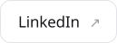</picture></a>
  <a href="mailto:m.bilal.25132@gmail.com"><picture><source media="(prefers-color-scheme: dark)" srcset="./assets/btn-email-dark.svg">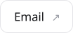</picture></a>
  <a href="https://mbilaltaha.com/Bilal_Taha_Resume.pdf"><picture><source media="(prefers-color-scheme: dark)" srcset="./assets/btn-resume-dark.svg"></picture></a>
</p>

I take LLM features from a notebook to something the public uses every day: the retrieval and agent layer in Python, the APIs and queues around it, and the interface on top. Most of my job is teaching very confident software to say *"I don't know"*.

Nearly all of my production code lives in private repos, so this page is a guided tour of what's inside them.

<picture>
  <source media="(prefers-color-scheme: dark)" srcset="./assets/metrics-dark.svg">
  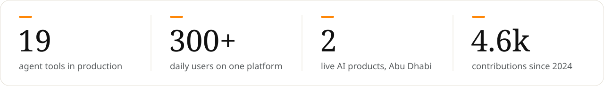
</picture>

## Now: the AI concierge for Abu Dhabi tourism

Working with **Create Group** for the **Department of Culture and Tourism – Abu Dhabi**, I build the conversational AI behind two products, front end and back end:

- **[Ask Abu Dhabi](https://mbilaltaha.com/work/dct-ai-chatbot)**: the AI assistant inside [visitabudhabi.ae](https://www.visitabudhabi.ae). It answers visitor questions about attractions, dining, hotels and events, and builds itineraries in chat.
- **[Digital Concierge](https://mbilaltaha.com/work/digital-concierge)**: a standalone AI trip planner with saved sessions, day-by-day itineraries and a live clustered map.

One request moving through the agent. The tool names are the real ones from production.

<picture>
  <source media="(prefers-color-scheme: dark)" srcset="./assets/trace-dark.svg">
  
</picture>

<details>
<summary><b>Architecture</b></summary>
<br>

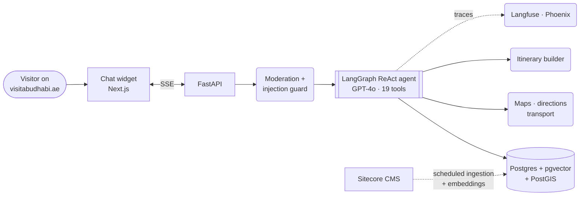

</details>

<details>
<summary><b>What I own on it</b></summary>
<br>

| Layer | Work |
|---|---|
| **Agent** | LangGraph ReAct agent on GPT-4o with 19 tools for search by category, itineraries, distance and directions, transport, links and response cards. Checkpointed conversations, with pruning so long sessions stay cheap. |
| **Retrieval** | Scheduled ingestion of CMS content into Postgres + pgvector, category- and location-aware search, and paginated, deduplicated results so the agent never recommends the same place twice. |
| **Safety** | Input moderation and prompt-injection defences in front of the agent, and links limited to an allow-list so the model can't invent a URL on a government site. |
| **Interface** | The embeddable chat widget on the host site and the Digital Concierge app: SSE streaming, rich listing cards, maps with Mapbox + Supercluster, and offline-friendly state in IndexedDB. |
| **Platform** | Azure B2C sign-in, feedback and reactions, share links, an admin panel for prompts and analytics, tracing with Langfuse and Phoenix, and Azure pipelines. |

</details>

## Selected work

<p>
  <a href="https://mbilaltaha.com/work/harbinger"><picture><source media="(prefers-color-scheme: dark)" srcset="./assets/card-harbinger-dark.svg">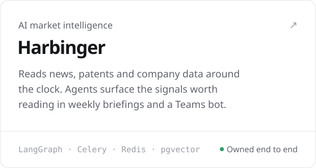</picture></a>
  <a href="https://mbilaltaha.com/work/medianet"><picture><source media="(prefers-color-scheme: dark)" srcset="./assets/card-medianet-dark.svg">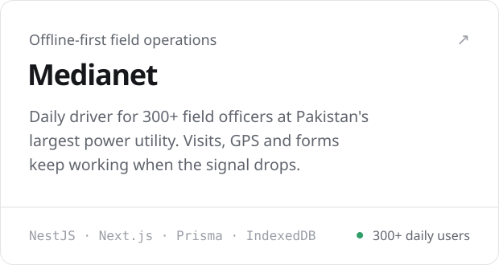</picture></a>
  <a href="https://github.com/bilaltaha25132/FYP-VidSense"><picture><source media="(prefers-color-scheme: dark)" srcset="./assets/card-vidsense-dark.svg">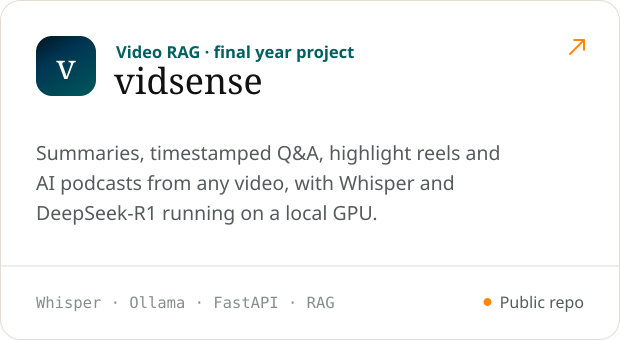</picture></a>
  <a href="https://github.com/bilaltaha25132/claude-nestjs"><picture><source media="(prefers-color-scheme: dark)" srcset="./assets/card-claude-nestjs-dark.svg">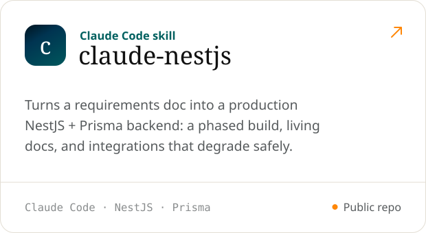</picture></a>
  <a href="https://github.com/bilaltaha25132/linkedin-post-generator"><picture><source media="(prefers-color-scheme: dark)" srcset="./assets/card-signal-desk-dark.svg">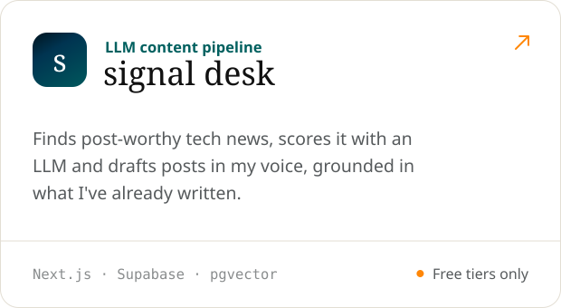</picture></a>
  <picture><source media="(prefers-color-scheme: dark)" srcset="./assets/card-remote-hands-dark.svg">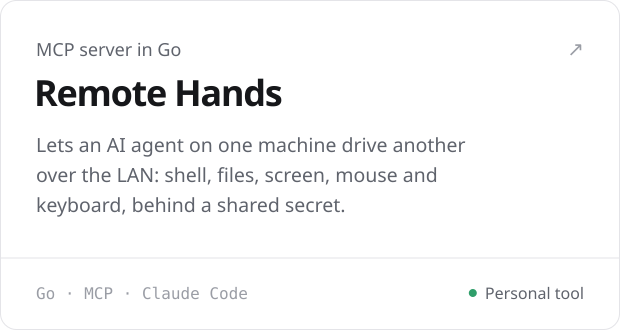</picture>
</p>

Also built: **Rihla**, a pilgrimage companion app with indoor maps of the Two Holy Mosques. **Baseline**, an astronaut health self-check PWA for NASA Space Apps 2026. And Claude Code skills that clone websites into Next.js and videos into Remotion templates.

## About me, as code

```python
from dataclasses import dataclass, field


@dataclass(frozen=True)
class BilalTaha:
    role: str = "Full Stack AI Engineer"
    based_in: str = "Karachi, Pakistan"
    now: str = "AI concierge for Abu Dhabi tourism"
    studied: str = "BS Computer Science, IBA Karachi"
    ships: tuple[str, ...] = ("RAG pipelines", "LangGraph agents", "APIs", "the UI on top")
    stack: dict[str, list[str]] = field(default_factory=lambda: {
        "llm": ["LangGraph", "LangChain", "OpenAI", "Azure OpenAI", "Ollama"],
        "retrieval": ["pgvector", "FAISS", "ChromaDB"],
        "llmops": ["Langfuse", "Arize Phoenix"],
        "backend": ["Python", "FastAPI", "Celery", "NestJS", "Node"],
        "frontend": ["Next.js", "React", "TypeScript", "Tailwind", "Flutter"],
        "data": ["PostgreSQL", "Redis", "MongoDB", "Prisma", "Docker", "Azure"],
    })

    def contact(self) -> str:
        return "m.bilal.25132@gmail.com"
```

## Writing

- [Let your chatbot say "I don't know"](https://mbilaltaha.com/blog/let-your-chatbot-say-i-dont-know)
- [The same story, five times: deduplicating before the LLM](https://mbilaltaha.com/blog/deduplicating-before-the-llm)
- [Building for people who lose signal](https://mbilaltaha.com/blog/building-for-people-who-lose-signal)
- [When the fast, dumb approach beats the smart one](https://mbilaltaha.com/blog/when-the-dumb-approach-wins)

## Activity

<picture>
  <source media="(prefers-color-scheme: dark)" srcset="./assets/activity-dark.svg">
  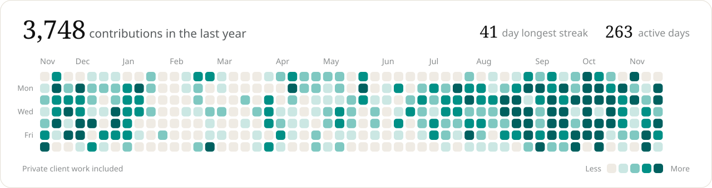
</picture>

---

If you're building LLM products that real users touch, I'd enjoy talking: [m.bilal.25132@gmail.com](mailto:m.bilal.25132@gmail.com) · [case studies](https://mbilaltaha.com/work) · [LinkedIn](https://linkedin.com/in/bilal-taha25132)

<sub>Every graphic on this page is generated by <a href="./scripts/build.py"><code>scripts/build.py</code></a>, set in Geist, and the heatmap is rebuilt daily by a GitHub Action.</sub>
